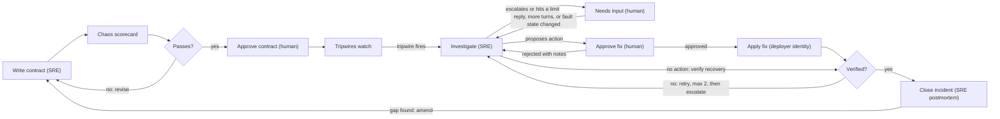
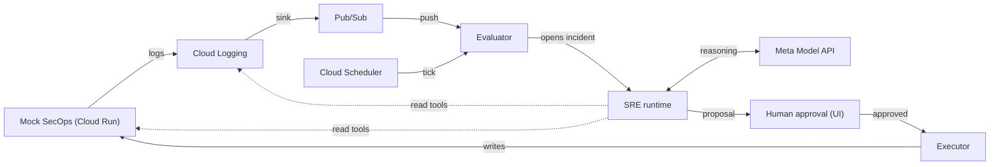

# Fleet SRE — Spec

As of 2026-10-28. Companion files: [`mocks.md`](mocks.md) (what is simulated and how), [`deliverables.md`](deliverables.md) (build order and acceptance tests).

This file is the source of truth. If `mocks.md` or `deliverables.md` disagrees with it, this file wins and the other file gets fixed.

Revised 2026-10-28 (afternoon) after reviewing Meta's `legal-agent-workshop`, `meta-model-cookbook` and `meta-oss-cookbook`: the investigation is now a gated loop with its checks inside the tools (§6.1, §6.3, §6.5); escalation pauses an incident instead of ending it; the executor journals before it writes; authoring has held-out scenarios; model IDs and API details are confirmed (§8).

Revised 2026-10-29 during D1: the contracts settled the fields and values in §5.

Revised 2026-10-29 (evening) after D2: every tool result reaches the model with its `callId` (§6.3); usage fields and cost confirmed (§8); the gated protocol passed live (§12).

Revised 2026-10-29 (night) before D3: Chronicle method bodies, permissions and connector log collection checked against Google's docs (`mocks.md` §4); `setLogsCollection` leaves the action allowlist (§6.4).

Revised 2026-10-31 after D4: boundary and recovery rules for each tripwire type, settled by the evaluator (§5).

---

## 1. Summary

Fleet SRE is an agentic site reliability engineer for MSSPs running multi-tenant Google SecOps SOAR. It writes each service's monitoring contract, investigates when a tripwire fires, proposes a fix for a human to approve, and amends the contract when an incident exposes a gap. The platform underneath exists only to give it safe tools and deterministic checks.

- **Problem.** An MSSP runs many tenants (SOAR environments) across many services in one instance. Connectors fail silently, a `LIVE` status can sit on a connector that ingests nothing, and each tenant's monitoring depends on who onboarded it.
- **What the SRE does.** Authors one contract per service version, investigates incidents with read-only tools, proposes allowlisted actions, writes the postmortem and drafts contract amendments.
- **Why it can be trusted.** It isn't. Deterministic code grades every output: contracts by a chaos scorecard, evidence when it is recorded, diagnoses when they are submitted, fixes by tripwires.
- **Fleet leverage.** Amendments land on the service contract, so one tenant's incident hardens every tenant on that service.
- **Built on.** A local-first Python system with a mock SecOps built against Google's published Chronicle API and SOAR log format, deployed to a personal GCP project (Cloud Logging, Pub/Sub, IAM, Cloud Run, Firestore).
- **Entry.** Meta Global AI Developer Hackathon, Indie track, "Build for Your World" theme. Submission due 2026-11-04 at 9:00 PM ET.

## 2. Design principles

1. **Verified, not trusted.** Every SRE output has a deterministic check: a contract must pass the chaos scorecard, evidence must exist when it is recorded, a diagnosis must rest on recorded evidence of the right kind, a fix must pass change-point tripwires.
2. **Reason once, run cheap.** The model works when a contract is written or amended and when an incident opens. No model sits in the watch loop.
3. **One contract per service.** The contract versions with the service definition. Per-tenant differences are parameters. The platform uses whatever integration version is installed; upgrades are a separate process.
4. **Every incident hardens every tenant.** Amendments land on the service contract, so a gap found on one tenant closes for all of them.
5. **The agent holds no credentials.** Read tools are proxied by the platform under a read-only identity; writes need human approval and run under a separate identity. IAM enforces this and tests prove it.
6. **Built against Google's spec.** Mock resources and log labels copy the published Chronicle API and SOAR logging docs, so the mock can be swapped for a real instance. What is invented is labelled as invented (see `mocks.md` §9).
7. **Local first.** Everything runs on a laptop with `make demo`. GCP services are adapters behind ports, swapped in late.
8. **The same rule applies to the build.** Humans write what defines correctness (contracts, scenarios, expected outcomes, acceptance test specs, SRE prompts in `prompts/`). The coding agent writes what is graded against them.
9. **Checks live inside the tools.** A gate runs inside the tool that moves work forward (recording evidence, submitting a diagnosis), never as a separate tool the model may choose to call, because a confident model skips optional checks. A refused call comes back as an error the model reads and fixes. The model chooses every call; code never hard-codes the order.

Field lessons that shape the tripwires: absence-only detection cannot tell quiet from broken, and a field changing type (severity arriving as a string) passes every volume check.

## 3. The SRE loop

The model acts at three points (author, investigate, close). Deterministic code grades each output before anything changes; inside an investigation, the gates sit in the tools (§6.1).



1. **Author.** Given a service brief, sample logs and parameters, the SRE drafts a contract. The harness scores it; the SRE revises against the scorecard (max 3 revisions); a human approves.
2. **Watch.** The evaluator runs every deployment's tripwires. No model call.
3. **Investigate.** A trip opens an incident. The SRE states hypotheses, investigates with read tools, records evidence that is checked as it is recorded, and submits a diagnosis through a gated tool (§6.1). The diagnosis proposes one action, proposes no action and asks for verification, or escalates.
4. **Hand off.** An escalation, or an investigation that hits a limit, pauses the incident at NEEDS_INPUT. No model calls are made while it waits. It resumes the same session only when something changed: a human replied, more turns were granted, or the incident's tripwire state changed (for example, a credential was rotated outside the platform).
5. **Approve and apply.** A human sees hypotheses, evidence and the patch diff, and approves or rejects with notes; notes go back to the SRE as its next message. On approval the executor journals its intent, then applies the change under the deployer identity.
6. **Verify.** A change-point window tightens checks on that component. The diagnosis states the expected outcome; the tripwires decide. Failure returns to investigation at most twice, then escalates.
7. **Close and learn.** The SRE writes a postmortem. If the incident exposed a gap (a late or missing trip), it drafts an amendment, which goes back through the scorecard and approval and then applies to every deployment of that service.

## 4. The platform

### 4.1 Domain model

- **Service**: a versioned contract (components + tripwires). Two ship: `alert-ingestion` (connector instance + ETL flow) and `intel-sync` (job instance).
- **Deployment**: a service applied to one SOAR environment, with parameters. Adding a deployment arms its tripwires.
- **Component**: one Chronicle resource per deployment, found in logs by its labels.
- **Incident**: opened by a trip; holds the investigation session (hypotheses, recorded evidence, transcript), the diagnosis, approvals and rejections, executor journal records, the verification result and the postmortem.

### 4.2 Ports and adapters

| Port | Local adapter (D3–D6) | GCP adapter (D7) |
| --- | --- | --- |
| `LogSink` | JSONL file | Cloud Logging `entries.write` |
| `LogSource` | JSONL replay / tail | Pub/Sub push from a log sink |
| `LogQuery` (SRE `query_logs`) | Scan JSONL store | Cloud Logging `entries.list` |
| `StateStore` | SQLite | Firestore |
| `Clock` | `SimClock` (tests, harness) or wall clock | Wall clock + Cloud Scheduler tick |
| `ChronicleClient` | Mock API over HTTP | Same mock on Cloud Run (a real instance is out of scope) |

The local log format is Cloud Logging's `LogEntry` JSON (see `mocks.md` §5), so fixtures, local replay and Cloud Logging share one structure.

### 4.3 Runtime (deployed)



State (deployments, tripwire state, incidents, investigation sessions, approvals, executor journal, transcripts) lives in Firestore when deployed, SQLite locally. The evaluator needs a clock as well as events, because silence never arrives as a message.

## 5. Contracts and tripwires

A contract is one JSON file per service version. Deployments supply parameters only. Full schema: `contracts/schema.json` (D1).

```json
{
  "service": "alert-ingestion",
  "version": "1.0.0",
  "parameters": {
    "expectedAlertsPerHour": { "type": "number", "required": true },
    "intervalSeconds": { "type": "integer", "required": true }
  },
  "components": [
    { "id": "connector", "kind": "connectorInstance",
      "logs": { "container_name": "python", "match": ["connector_name", "connector_instance"], "deploymentBy": "labels.connector_instance" } },
    { "id": "ingestion", "kind": "etlFlow",
      "logs": { "container_name": "etl", "match": ["correlation_id"], "deploymentBy": "jsonPayload.environment" } }
  ],
  "tripwires": [
    { "id": "dead-connector", "component": "connector", "type": "cadence",
      "spec": { "event": "connector.run.completed", "intervalSeconds": "${intervalSeconds}", "maxSilentIntervals": 3 } },
    { "id": "canary", "component": "ingestion", "type": "synthetic",
      "spec": { "everyMinutes": 10, "deadlineSeconds": 180 } },
    { "id": "priority-shape", "component": "ingestion", "type": "schema",
      "spec": { "event": "alert.ingested", "field": "jsonPayload.alert.priority", "type": "integer", "enum": [-1, 40, 60, 80, 100], "required": true, "consecutive": 1, "recoverAfter": 20 } },
    { "id": "connector-errors", "component": "connector", "type": "errorSignature",
      "spec": { "minSeverity": "WARNING", "windowRuns": 10, "threshold": 8 } }
  ],
  "changePoint": { "durationSeconds": 1800, "overrides": { "dead-connector": { "maxSilentIntervals": 2 } } },
  "provenance": { "authoredBy": "<model id>", "scorecard": "<run id>", "approvedBy": "<human>" }
}
```

Values were settled in D1; `contracts/*.json` is authoritative and this example matches it. The `intel-sync` contract has one `jobInstance` component and three tripwires: `dead-job` (cadence on `job.run.completed`, 3 silent intervals), `hollow-run` (schema on `job.run.completed` entries whose `status` is `SUCCESS`: `jsonPayload.indicatorsSynced` ≥ 1, tripping after 3 consecutive violations and recovering after 2 valid runs) and `job-errors` (errorSignature, 2 ERROR runs in the last 3).

**Contract rules settled in D1.**

- `logs.deploymentBy` names the entry field that identifies the deployment: `labels.connector_instance` for connectors, and the invented `jsonPayload.environment` for jobs and ETL. Google's documented job label (`job_name`) names the job definition, which is the same on every tenant, and ETL entries carry only `correlation_id`.
- Cadence specs name their interval explicitly (`"intervalSeconds": "${intervalSeconds}"`).
- Schema tripwires take `event` (only entries with that `jsonPayload.event` are checked), `where` (equality filters on other fields), `consecutive` (violations in a row to trip; default 1) and `recoverAfter` (valid entries in a row to recover; default `consecutive`). Entries the filters exclude neither count nor reset either run.
- For `errorSignature`, a run is one `runId`, its severity is the worst entry in it, and it is judged when it completes (the component's cadence heartbeat). It trips when at least `threshold` of the last `windowRuns` runs are at or above `minSeverity`, and recovers after `windowRuns − threshold + 1` clean runs in a row.
- Entering a change point re-arms cadence from that moment: a heartbeat from before the change point never counts.
- Cadence goes by the latest heartbeat timestamp seen, not the last entry to arrive, and trips when the silence is strictly longer than `maxSilentIntervals × intervalSeconds`. It recovers on the first heartbeat that clears that condition.
- A canary seen exactly at its deadline is in time. A late canary does not recover the tripwire; the next canary seen in time does.
- `load_contract` rejects a bad contract with a `ContractError` code (table in `deliverables.md` §D1).

| Tripwire type | Checks | Trips when | Failure it catches |
| --- | --- | --- | --- |
| `cadence` | A named heartbeat event (connector run, job run) against the deployment's interval | No event for N intervals | A stopped connector or job. Runs happen on schedule regardless of alert volume, so quiet tenants do not false-alarm |
| `synthetic` | A planted canary alert traced end to end by `correlation_id` | The canary misses its deadline | End-to-end breakage with a healthy-looking status |
| `schema` | Field presence, type and allowed values on ingested events | A required field is missing, the wrong type, or out of range | Silent type breakage that volume checks miss |
| `errorSignature` | WARNING/ERROR rate in a component's logs over the last N runs | Count ≥ threshold | A per-tenant credential Green Liar, without planting anything in the client's SIEM |

**Canary scope.** In the demo the canary is planted in the fake upstream per tenant. In production, planting into a client's workspace is off the table, so the canary runs on one MSSP-owned canary tenant per service version (proves the code path), and `errorSignature` covers per-tenant credential failures.

### 5.1 Chaos harness and scorecard

- **Scenario library** (`fixtures/scenarios/<service>/*.yaml`, human-authored): fleet, duration, fault schedule, expected trips with a maximum detection latency, and `mustNotTrip`.
- **Replay**: the mock world generates each scenario's log stream on a `SimClock`; the stream runs through the evaluator. No GCP, seconds per run.
- **Scorecard**: per scenario, expected versus actual trips, detection latency, false positives. A contract passes only at 100% expected trips and zero false positives.
- **The SRE never writes scenarios or expected outcomes.** It sees scorecard results only.
- **Held-out scenarios.** Some scenarios are marked `holdout: true`. They never appear in revision feedback, not even by ID. A contract passes only if the holdouts pass too; when only a holdout fails, the feedback says "a held-out scenario failed" and nothing more. This stops the authoring loop from fitting the visible scenarios.

## 6. The investigation: loop, tools, actions and gates

### 6.1 The loop

Each turn, the gateway sends the full history to the Meta Model API (Responses API, `store=False`, `parallel_tool_calls=False`, encrypted reasoning included and replayed; §8). The model returns one tool call; the platform runs it; the result, or the gate's refusal, goes back as the next input. The session is saved after every turn.

- **One tool per turn.** A reply with no tool call gets "Plain text is not accepted. Call exactly one tool." and counts as a turn. If a response holds more than one call, only the first runs.
- **Last turn.** On the final turn the SRE is told to submit with what it has.
- **Rationale.** Every tool call carries a required `rationale` (at most 200 characters). The model's reasoning tokens are not readable (Chat Completions returns no `reasoning_content`; Responses returns it encrypted), so `rationale` is the visible "think" line in the trace and the UI timeline.
- **Ending.**

| Ends with | Incident goes to | Model calls afterwards |
| --- | --- | --- |
| `submit_diagnosis` accepted, action `propose` | AWAITING_APPROVAL | None until approval or rejection |
| `submit_diagnosis` accepted, action `none` | VERIFYING | None |
| `submit_diagnosis` accepted, action `escalate` | NEEDS_INPUT, reason `escalated` | None until resumed |
| Three refused submissions | NEEDS_INPUT, reason `refused` | None until resumed |
| Turn limit | NEEDS_INPUT, reason `budget` | None until resumed |
| Token limit | NEEDS_INPUT, reason `token_budget` | None until resumed |
| The same call a third time | NEEDS_INPUT, reason `stuck` | None until resumed |
| Model API still failing after retries | NEEDS_INPUT, reason `model_unavailable` | None until resumed |

- **Resume.** A NEEDS_INPUT incident resumes the same session (hypotheses and evidence kept) only when a human replied, granted more turns, or the incident's tripwire state changed since it paused. Otherwise resume is refused without a model call. What changed is the SRE's next message.
- **Gates off (evals only).** Gates can be switched off to measure what they catch; each verdict they would have given is still recorded. The incident manager and the web app refuse an investigator with gates off.

### 6.2 Read tools (proxied, read-only identity)

Every read tool also takes `rationale`. Reads are capped at 12 per session; a 13th read is refused with an error, and the loop continues.

| Tool | Returns | Backed by |
| --- | --- | --- |
| `query_logs(deployment, window, filter)` | Log entries with `insertId` | `LogQuery` port |
| `get_resource(name)` | A connector instance, job instance, integration instance or environment | Mock Chronicle API `get` |
| `list_connector_logs(connectorInstance)` | Recent `ConnectorLog` records (empty unless log collection is on for that instance) | Mock `connectorInstances.logs.list` |
| `list_job_logs(jobInstance)` | Recent `JobInstanceLog` records | Mock `jobInstances.logs.list` |
| `test_integration_instance(name)` | Connectivity test result | Mock `integrationInstances.executeTest` (changes no state) |
| `compare_siblings(service, component, window)` | The same component's signals across every deployment of the service | Platform, computed |
| `tripwire_history(deployment)` | Recent trips, recoveries and approved changes | Platform state |
| `get_contract(service)` | Current contract and its last scorecard | Platform registry |

### 6.3 Working tools and their gates

The gates run inside these tools. A refused call returns `{"error": "...", "problems": ["..."]}` and never raises. Every tool result reaches the model as `{"callId": "...", "result": {...}}`, because the model cannot read call IDs back from the replayed history (D2 finding). A tool source's `field` is a dotted path into `result` (`successful`, not `result.successful`).

| Tool | Does | Gate (inside the tool) |
| --- | --- | --- |
| `set_hypotheses(items)` | Sets 2–4 hypotheses, each with a statement and the evidence that would confirm it | 2–4 items; at least one marked `alternative: true` (a competing explanation, such as "this is fleet-wide, not specific to this tenant"). Required before `record_evidence` or `submit_diagnosis`. Calling it again replaces the set; evidence for removed hypotheses is dropped |
| `update_plan(plan)` | Records how the SRE will settle each hypothesis | None |
| `record_evidence(hypothesis, stance, source, why)` | Records one piece of evidence for (`supports`) or against (`refutes`) one hypothesis. `source` is `{insertId}` for a log entry or `{callId, field, value}` for a tool result | Log source: the `insertId` exists and belongs to the incident's deployment or to a sibling deployment the SRE queried in this session. Tool source: `callId` is a call made in this session and its result has `field` equal to `value`. The hypothesis exists. At most 3 items per hypothesis. Returns the evidence ID (`E1`, `E2`, …) and the hypotheses that still have no evidence |
| `submit_diagnosis(diagnosis)` | Submits the diagnosis (§6.5) | The submission rules in §6.5 |

### 6.4 Action allowlist

| Action | Notes |
| --- | --- |
| `connectorInstances.patch` | `updateMask` limited to `enabled`, `intervalSeconds`, `parameters` |
| `connectorInstances.restart` | Platform macro: patch `enabled=false`, then `enabled=true` |
| `connectorInstances.runOnDemand` | |
| `jobInstances.patch` | `updateMask` limited to `enabled`, `parameters` |
| `jobInstances.restart` | Platform macro: patch `enabled=false`, then `enabled=true` |
| `jobInstances.runOnDemand` | |
| `none` | No write: the fault has cleared (for example, after a human acted on an escalation). Goes straight to verification |
| `escalate` | Required when the fix is outside the allowlist (e.g. a credential rotation). Pauses the incident at NEEDS_INPUT |

`connectorInstances.setLogsCollection` is not an action: turning on logging fixes nothing, so verification would fail it. The SRE can ask for it in an `escalationSummary`.

### 6.5 Diagnosis schema and submission rules

```json
{
  "incidentId": "string",
  "deployment": "string",
  "component": "string",
  "category": "connector_stalled | job_stalled | credential_failure | schema_drift | job_hollow_success | job_failing | unknown",
  "hypothesis": "ID of the hypothesis the SRE concludes (from set_hypotheses)",
  "summary": "the conclusion in one or two sentences",
  "evidence": ["E1", "E3"],
  "openQuestions": [ { "hypothesis": "string", "why": "string" } ],
  "action": {
    "type": "propose | none | escalate",
    "method": "one of the allowlist, when type is propose",
    "resource": "full resource name",
    "updateMask": ["field"],
    "patch": {},
    "escalationSummary": "string, when type is escalate"
  },
  "expectedVerification": { "tripwire": "string", "condition": "recovers_within", "seconds": 0 },
  "rollback": "string",
  "confidence": "low | medium | high"
}
```

`category` is an enum so evaluations grade deterministically. The tool schema sets `additionalProperties: false` throughout.

`submit_diagnosis` refuses a diagnosis, listing every problem, unless:

1. **Schema.** It validates against the schema above.
2. **Recorded evidence only.** Every ID in `evidence` was recorded in this session.
3. **Hypothesis coverage.** The concluded hypothesis has at least one cited `supports` item. Every other hypothesis has at least one recorded `refutes` item or an entry in `openQuestions`.
4. **Category evidence rule.** The cited evidence includes what the category requires (table below).
5. **Action.** `propose`: the method is in §6.4, `updateMask` is within its allowed fields, and `resource` is the incident's component. `propose` and `none`: `expectedVerification.tripwire` is a tripwire of the incident's deployment. `none`: at least one cited item was recorded after the session's most recent resume. `escalate`: `escalationSummary` is not empty.

After three refused submissions the incident goes to NEEDS_INPUT with reason `refused`.

**Category evidence rules.** These check deterministically that the evidence is the right kind for the conclusion. They stand in for the model-judged "claims check" other agents use.

| Category | Cited evidence must include |
| --- | --- |
| `connector_stalled` | The deployment's last `connector.run.completed` entry before the trip |
| `job_stalled` | The deployment's last `job.run.completed` entry before the trip |
| `credential_failure` | A WARNING or ERROR entry from the deployment's connector, and a `test_integration_instance` result with `successful: false` |
| `schema_drift` | An `alert.ingested` entry that violates the tripped schema tripwire |
| `job_hollow_success` | A `job.run.completed` entry with `indicatorsSynced: 0` |
| `job_failing` | A `job.run.error` entry, or a `job.run.completed` entry with `status: ERROR` |
| `unknown` | Nothing, but the action must be `escalate` |

### 6.6 Guardrails

- **Gates inside the tools** (§6.3, §6.5). Refusals are fed back to the model; nothing is retried silently.
- **Budgets.** Per investigation session: 24 turns, 12 read calls, 400,000 tokens (input plus output, configurable). Two remediation attempts per incident.
- **Stuck detection.** The same tool with the same canonical arguments (keys sorted, `rationale` excluded) a third time ends the session with reason `stuck`.
- **Concurrency.** The executor rejects a patch if the resource changed since the SRE read it.
- **Executor journal.** Append-only. Before any write the executor appends `intent` (approval ID, proposal hash, the resource version read at proposal time), then `started`, then `terminal` with the result. No write happens without a durable `intent` first. On restart, an `intent` without `terminal` is reconciled by re-reading the resource: if the change is already there it is marked done; otherwise it is applied once.
- **Recorded replay.** Live investigations chosen as fixtures (`fixtures/recorded/`) replay offline in CI through the scripted transport. Any difference in tool calls, gate verdicts or the final diagnosis blocks the merge.
- **Model calls.** Exponential backoff on 429; diagnoses cached on the public instance; spend caps.
- **Import boundary.** `fleetsre.sre` may not import GCP clients or the Chronicle client directly; it reaches the world only through the tool set.

## 7. Identity and IAM

| Identity | Grants | Must not be able to |
| --- | --- | --- |
| `obs-reader` (evaluator, SRE read tools) | `roles/logging.viewer`; `roles/pubsub.subscriber` on the one subscription; read permissions on the mock API | Write logs; call mock write methods |
| `deployer` (executor) | Write permissions on the mock API | Read the subscription; act without an approval record |
| `mock-soar` (mock SecOps runtime) | `roles/logging.logWriter` | Anything else |
| SRE (model) | None | Call GCP or the mock API directly |

No service-account keys. Locally: impersonation. Cloud Run: attached service accounts. The mock verifies the caller's Google ID token and maps the service-account email to Chronicle-style permissions (`chronicle.connectorInstances.get`, `chronicle.connectorInstanceLogs.get`, ...). Tests: positive paths, negative 403s, exact permission sets via `testIamPermissions`, and no user-managed keys (`deliverables.md` D7).

## 8. Model usage

One gateway, per-role config. Assignments are provisional until the D2 spike and the D5 live eval.

| Role | Frequency | Starting model | Reasoning effort |
| --- | --- | --- | --- |
| Author / amend contracts | Rare | Muse Wonder via Meta Model API (model ID to confirm on the dashboard) | `high` |
| Investigate / propose | Per incident | `muse-spark-1.3` via Meta Model API | `medium` |
| Postmortem | Per closed incident | `muse-spark-1.3` | `low` |
| Fallback | On rate limits | Muse Spark Open from a partner, if credits arrive: Baseten `meta-models/muse-spark-open` (base URL `https://inference.baseten.co/v1`) or Fireworks `accounts/fireworks/models/muse-spark-open` | `medium` |
| Building the project | Throughout | Muse Code | — |

**API details** (from Meta's cookbooks):

- **Endpoint and key.** Base URL `https://api.meta.ai/v1`. The key lives in `MODEL_API_KEY` and is passed explicitly; the OpenAI SDK does not read that variable on its own.
- **Investigation loop.** Responses API with `store=False` and the full history sent every turn, `include=["reasoning.encrypted_content"]` so reasoning is replayed between turns, `parallel_tool_calls=False`, and `reasoning={"effort": ...}` per role. Effort levels: `none` < `minimal` < `low` < `medium` < `high` (`xhigh` is the same as `high`).
- **JSON outside tools** (authoring, postmortem). On the Responses API use `text.format` with a JSON schema; `response_format` returns HTTP 400 there. A recursive `$ref` also returns 400, so the schema given to the authoring model must be flattened.
- **Prompt caching.** Keep the stable prefix first (system prompt, tool specs, contract) and record `usage.input_tokens_details.cached_tokens` and `usage.output_tokens_details.reasoning_tokens` in the transcript (field names confirmed in D2).
- **Cost.** Muse Spark is billed against the $150 credit on this account (D2: about $0.08 per investigation at ~120k input tokens, ~70% cached). Baseten, Modal and Fireworks each offer $100 to select participants for open-weights models.

Muse Code bills the same $150 credit (verified by usage delta).

## 9. Build plan

Two merges per deliverable: a tests PR, then an implementation PR. Details and full acceptance tests in `deliverables.md`.

| Day | Deliverables |
| --- | --- |
| Wed Oct 28 | D0 scaffold and guardrails · D1 contracts, log contract, scenarios (human) · D2 SRE feasibility spike |
| Thu Oct 29 | D3 mock SecOps (local) · D4 evaluator and chaos harness |
| Fri Oct 30 | D5 SRE investigator |
| Sat Oct 31 | D6 fix loop, authoring, amendment |
| Sun Nov 1 | D7 GCP adapters and IAM |
| Mon Nov 2 | D8 UI, live chaos loop, deploy |
| Tue Nov 3 | Feature freeze, README, video |
| Wed Nov 4 | Submit by 9:00 PM ET |

**Cut order if a day slips:** (1) second service in the video, (2) UI polish, including step mode, (3) public chaos loop, (4) amendment step. Never cut the investigation loop and its gates, the authoring scorecard loop or the Green Liar beat.

## 10. Demo (3:00 max)

| Time | Beat |
| --- | --- |
| 0:00–0:20 | The MSSP problem: tenants × services, silent failures, `LIVE` while nothing arrives |
| 0:20–0:50 | SRE authors a contract; scorecard fails a scenario; it revises and passes, including held-out scenarios it never saw; human approves |
| 0:50–1:05 | Fleet grid: two services, three tenants, one low-volume, all green |
| 1:05–2:15 | Stall trips cadence while the quiet tenant stays green. Credential Green Liar trips errorSignature and canary; the timeline shows each turn's rationale, tool call and gate verdict: hypotheses (credential versus fleet-wide), `compare_siblings`, `test_integration_instance`, escalation. The incident waits with no model calls; "mark rotated"; the same incident resumes and the tripwires confirm recovery. Severity drift trips schema; SRE proposes a parameter patch; approval; tripwires confirm recovery |
| 2:15–2:30 | SRE drafts an amendment; rescored, approved, applied to every tenant |
| 2:30–2:50 | Checks off versus on: the same live runs with gates off, and how many bad submissions the gates refused. Architecture; IAM tests showing reader and SRE get 403s |
| 2:50–3:00 | What was built during the hackathon; repo and live link |

Live instance: Cloud Run, scheduled chaos loop, no public fault buttons, no public approvals, capped model calls. So that the public page shows recoveries unattended, a demo auto-approver stands in for the human on chaos-loop incidents, and when an F2 incident reaches NEEDS_INPUT the chaos loop clears the fault. Every such action is labelled as a demo action ("demo auto-approval", "demo: credential rotated").

## 11. Hackathon compliance

- Public repo; no employer names, systems, code, data or screenshots. Synthetic data only. No keys committed.
- First commit on 2026-10-28; README section "Built during the hackathon". Pre-event planning docs labelled as such.
- No code imported from personal projects. Patterns from Meta's `legal-agent-workshop` (which has no license file) and the cookbooks are reimplemented, not copied.
- Muse Code session exports (`muse export`) are committed under `provenance/` after the secret scan passes, as a record of what was built in each session.
- Video ≤ 3:00, showing only hackathon-built features.
- Employment agreement IP clause checked before the first public push.
- Spend limit on Meta billing; budget alert on the GCP project.

## 12. Risks and open questions

| Risk | Mitigation |
| --- | --- |
| Meta API rate limits | Backoff, cache, gateway fallback |
| Weak code from the coding agent | Tests-first PRs, human review per deliverable |
| Logging API rejects `k8s_container` labels from outside GKE | Checked by hand on D1 day; fallback to a generic resource with the same entry `labels` |
| SRE wanders or fabricates evidence | Budgets, stuck detection, evidence checked when recorded, category evidence rules |
| The model does not follow the gated protocol (one call per turn, hypotheses first) | D2 passed with the full protocol (`spikes/RESULTS.md`). If a later model fails it, fallback order: drop `update_plan`; then drop `set_hypotheses` (rule 3 of §6.5 becomes report-only); then pre-computed evidence in the incident |
| Authoring fits the visible scenarios | Held-out scenarios (§5.1) |
| Live instance abuse or cost | Public mode, caps |

Open: partner credits for the fallback; Muse Wonder's model ID; model per role after evals; escalation channel (UI only or email); whether `intel-sync` appears in the video.

## Sources

- Chronicle API (v1): [connectorInstances](https://docs.cloud.google.com/chronicle/docs/reference/rest/v1/projects.locations.instances.integrations.connectors.connectorInstances), [connectorInstances.logs](https://docs.cloud.google.com/chronicle/docs/reference/rest/v1beta/projects.locations.instances.integrations.connectors.connectorInstances.logs), [integrationInstances](https://docs.cloud.google.com/chronicle/docs/reference/rest/v1/projects.locations.instances.integrations.integrationInstances), [jobInstances](https://docs.cloud.google.com/chronicle/docs/reference/rest/v1/projects.locations.instances.integrations.jobs.jobInstances), [jobInstances.logs](https://docs.cloud.google.com/chronicle/docs/reference/rest/v1/projects.locations.instances.integrations.jobs.jobInstances.logs), [environments](https://docs.cloud.google.com/chronicle/docs/reference/rest/v1/projects.locations.instances.environments)
- [Collect Google SecOps SOAR logs](https://docs.cloud.google.com/chronicle/docs/secops/collect-secops-soar-logs)
- [Create a custom connector (AlertInfo, priority scale)](https://docs.cloud.google.com/chronicle/docs/soar/respond/ide/creating-a-custom-connector)
- [Microsoft Sentinel Incidents – List](https://learn.microsoft.com/en-us/rest/api/securityinsights/incidents/list)
- [Hackathon participant guide](https://cerebralvalley.ai/e/meta-ai-developer-hackathon/details)
- Meta: [legal-agent-workshop](https://github.com/meta-models/legal-agent-workshop) (gated tools, escalation and resume, sign-off), [meta-model-cookbook](https://github.com/meta-models/meta-model-cookbook) (agent loop guards, structured output, reasoning, Muse Code audit log and replay), [meta-oss-cookbook](https://github.com/meta-models/meta-oss-cookbook) (Muse Spark Open hosted providers)
