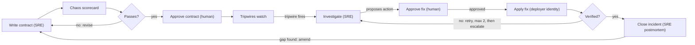
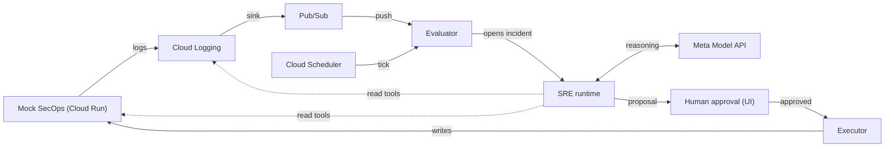

# Fleet SRE — Spec

As of 2026-10-28. Companion files: [`mocks.md`](mocks.md) (what is simulated and how), [`deliverables.md`](deliverables.md) (build order and acceptance tests).

This file is the source of truth. If `mocks.md` or `deliverables.md` disagrees with it, this file wins and the other file gets fixed.

---

## 1. Summary

Fleet SRE is an agentic site reliability engineer for MSSPs running multi-tenant Google SecOps SOAR. It writes each service's monitoring contract, investigates when a tripwire fires, proposes a fix for a human to approve, and amends the contract when an incident exposes a gap. The platform underneath exists only to give it safe tools and deterministic checks.

- **Problem.** An MSSP runs many tenants (SOAR environments) across many services in one instance. Connectors fail silently, a `LIVE` status can sit on a connector that ingests nothing, and each tenant's monitoring depends on who onboarded it.
- **What the SRE does.** Authors one contract per service version, investigates incidents with read-only tools, proposes allowlisted actions, writes the postmortem and drafts contract amendments.
- **Why it can be trusted.** It isn't. Deterministic code grades every output: contracts by a chaos scorecard, diagnoses by evidence citations, fixes by tripwires.
- **Fleet leverage.** Amendments land on the service contract, so one tenant's incident hardens every tenant on that service.
- **Built on.** A local-first Python system with a mock SecOps built against Google's published Chronicle API and SOAR log format, deployed to a personal GCP project (Cloud Logging, Pub/Sub, IAM, Cloud Run, Firestore).
- **Entry.** Meta Global AI Developer Hackathon, Indie track, "Build for Your World" theme. Submission due 2026-11-04 at 9:00 PM ET.

## 2. Design principles

1. **Verified, not trusted.** Every SRE output has a deterministic check: a contract must pass the chaos scorecard, a diagnosis must cite log entries that exist, a fix must pass change-point tripwires.
2. **Reason once, run cheap.** The model works when a contract is written or amended and when an incident opens. No model sits in the watch loop.
3. **One contract per service.** The contract versions with the service definition. Per-tenant differences are parameters. The platform uses whatever integration version is installed; upgrades are a separate process.
4. **Every incident hardens every tenant.** Amendments land on the service contract, so a gap found on one tenant closes for all of them.
5. **The agent holds no credentials.** Read tools are proxied by the platform under a read-only identity; writes need human approval and run under a separate identity. IAM enforces this and tests prove it.
6. **Built against Google's spec.** Mock resources and log labels copy the published Chronicle API and SOAR logging docs, so the mock can be swapped for a real instance. What is invented is labelled as invented (see `mocks.md` §9).
7. **Local first.** Everything runs on a laptop with `make demo`. GCP services are adapters behind ports, swapped in late.
8. **The same rule applies to the build.** Humans write what defines correctness (contracts, scenarios, expected outcomes, acceptance test specs, SRE prompts in `prompts/`). The coding agent writes what is graded against them.

Field lessons that shape the tripwires: absence-only detection cannot tell quiet from broken, and a field changing type (severity arriving as a string) passes every volume check.

## 3. The SRE loop

The model acts at three points (author, investigate, close). Deterministic code grades each output before anything changes.



1. **Author.** Given a service brief, sample logs and parameters, the SRE drafts a contract. The harness scores it; the SRE revises against the scorecard (max 3 revisions); a human approves.
2. **Watch.** The evaluator runs every deployment's tripwires. No model call.
3. **Investigate.** A trip opens an incident. The SRE uses read tools, compares sibling deployments, and returns a structured diagnosis with cited evidence and one proposed action or an escalation.
4. **Approve and apply.** A human sees hypothesis, evidence and patch diff. On approval the executor applies it under the deployer identity.
5. **Verify.** A change-point window tightens checks on that component. The diagnosis states the expected outcome; the tripwires decide. Failure returns to investigation at most twice, then escalates.
6. **Close and learn.** The SRE writes a postmortem. If the incident exposed a gap (a late or missing trip), it drafts an amendment, which goes back through the scorecard and approval and then applies to every deployment of that service.

## 4. The platform

### 4.1 Domain model

- **Service**: a versioned contract (components + tripwires). Two ship: `alert-ingestion` (connector instance + ETL flow) and `intel-sync` (job instance).
- **Deployment**: a service applied to one SOAR environment, with parameters. Adding a deployment arms its tripwires.
- **Component**: one Chronicle resource per deployment, found in logs by its labels.
- **Incident**: opened by a trip; holds the investigation transcript, diagnosis, approval, verification result and postmortem.

### 4.2 Ports and adapters

| Port | Local adapter (D3–D6) | GCP adapter (D7) |
| --- | --- | --- |
| `LogSink` | JSONL file | Cloud Logging `entries.write` |
| `LogSource` | JSONL replay / tail | Pub/Sub push from a log sink |
| `LogQuery` (SRE `query_logs`) | Scan JSONL store | Cloud Logging `entries.list` |
| `StateStore` | SQLite | Firestore |
| `Clock` | `SimClock` (tests, harness) or wall clock | Wall clock + Cloud Scheduler tick |
| `ChronicleClient` | Mock API over HTTP | Same mock on Cloud Run (a real instance is out of scope) |

The local log format is Cloud Logging's `LogEntry` JSON (see `mocks.md` §5), so fixtures, local replay and Cloud Logging share one structure.

### 4.3 Runtime (deployed)



State (deployments, tripwire state, incidents, approvals, transcripts) lives in Firestore when deployed, SQLite locally. The evaluator needs a clock as well as events, because silence never arrives as a message.

## 5. Contracts and tripwires

A contract is one JSON file per service version. Deployments supply parameters only. Full schema: `contracts/schema.json` (D1).

```json
{
  "service": "alert-ingestion",
  "version": "1.0.0",
  "parameters": {
    "expectedAlertsPerHour": { "type": "number", "required": true },
    "intervalSeconds": { "type": "integer", "required": true }
  },
  "components": [
    { "id": "connector", "kind": "connectorInstance",
      "logs": { "container_name": "python", "match": ["connector_name", "connector_instance"] } },
    { "id": "ingestion", "kind": "etlFlow",
      "logs": { "container_name": "etl", "match": ["correlation_id"] } }
  ],
  "tripwires": [
    { "id": "dead-connector", "component": "connector", "type": "cadence",
      "spec": { "event": "connector.run.completed", "maxSilentIntervals": 3 } },
    { "id": "canary", "component": "ingestion", "type": "synthetic",
      "spec": { "everyMinutes": 10, "deadlineSeconds": 180 } },
    { "id": "priority-shape", "component": "ingestion", "type": "schema",
      "spec": { "field": "jsonPayload.alert.priority", "type": "integer", "enum": [-1, 40, 60, 80, 100], "required": true } },
    { "id": "connector-errors", "component": "connector", "type": "errorSignature",
      "spec": { "minSeverity": "WARNING", "windowRuns": 5, "threshold": 3 } }
  ],
  "changePoint": { "durationSeconds": 1800, "overrides": { "dead-connector": { "maxSilentIntervals": 1 } } },
  "provenance": { "authoredBy": "<model id>", "scorecard": "<run id>", "approvedBy": "<human>" }
}
```

Values are starting points; D1 finalises them. The `intel-sync` contract has one `jobInstance` component and three tripwires: `dead-job` (cadence on `job.run.completed`), `hollow-run` (schema: `jsonPayload.indicatorsSynced` ≥ 1, tripping after K consecutive violations) and `job-errors` (errorSignature).

| Tripwire type | Checks | Trips when | Failure it catches |
| --- | --- | --- | --- |
| `cadence` | A named heartbeat event (connector run, job run) against the deployment's interval | No event for N intervals | A stopped connector or job. Runs happen on schedule regardless of alert volume, so quiet tenants do not false-alarm |
| `synthetic` | A planted canary alert traced end to end by `correlation_id` | The canary misses its deadline | End-to-end breakage with a healthy-looking status |
| `schema` | Field presence, type and allowed values on ingested events | A required field is missing, the wrong type, or out of range | Silent type breakage that volume checks miss |
| `errorSignature` | WARNING/ERROR rate in a component's logs over the last N runs | Count ≥ threshold | A per-tenant credential Green Liar, without planting anything in the client's SIEM |

**Canary scope.** In the demo the canary is planted in the fake upstream per tenant. In production, planting into a client's workspace is off the table, so the canary runs on one MSSP-owned canary tenant per service version (proves the code path), and `errorSignature` covers per-tenant credential failures.

### 5.1 Chaos harness and scorecard

- **Scenario library** (`fixtures/scenarios/<service>/*.yaml`, human-authored): fleet, duration, fault schedule, expected trips with a maximum detection latency, and `mustNotTrip`.
- **Replay**: the mock world generates each scenario's log stream on a `SimClock`; the stream runs through the evaluator. No GCP, seconds per run.
- **Scorecard**: per scenario, expected versus actual trips, detection latency, false positives. A contract passes only at 100% expected trips and zero false positives.
- **The SRE never writes scenarios or expected outcomes.** It sees scorecard results only.

## 6. SRE tools, actions and guardrails

### 6.1 Read tools (proxied, read-only identity)

| Tool | Returns | Backed by |
| --- | --- | --- |
| `query_logs(deployment, window, filter)` | Log entries with `insertId` | `LogQuery` port |
| `get_resource(name)` | A connector instance, job instance, integration instance or environment | Mock Chronicle API `get` |
| `list_connector_logs(connectorInstance)` | Recent `ConnectorLog` records | Mock `connectorInstances.logs.list` |
| `list_job_logs(jobInstance)` | Recent `JobInstanceLog` records | Mock `jobInstances.logs.list` |
| `test_integration_instance(name)` | Connectivity test result | Mock `integrationInstances.executeTest` (changes no state) |
| `compare_siblings(service, component, window)` | The same component's signals across every deployment of the service | Platform, computed |
| `tripwire_history(deployment)` | Recent trips, recoveries and approved changes | Platform state |
| `get_contract(service)` | Current contract and its last scorecard | Platform registry |

### 6.2 Action allowlist (proposals only)

| Action | Notes |
| --- | --- |
| `connectorInstances.patch` | `updateMask` limited to `enabled`, `intervalSeconds`, `parameters` |
| `connectorInstances.restart` | Platform macro: patch `enabled=false`, then `enabled=true` |
| `connectorInstances.runOnDemand` | |
| `connectorInstances.setLogsCollection` | |
| `jobInstances.patch` | `updateMask` limited to `enabled`, `parameters` |
| `jobInstances.restart` | Platform macro: patch `enabled=false`, then `enabled=true` |
| `jobInstances.runOnDemand` | |
| `escalate` | Required when the fix is outside the allowlist (e.g. a credential rotation) |

### 6.3 Diagnosis schema

```json
{
  "incidentId": "string",
  "deployment": "string",
  "component": "string",
  "category": "connector_stalled | job_stalled | credential_failure | schema_drift | job_hollow_success | job_failing | unknown",
  "hypothesis": "string",
  "evidence": [ { "insertId": "string", "why": "string" } ],
  "action": {
    "type": "propose | escalate",
    "method": "one of the allowlist",
    "resource": "full resource name",
    "updateMask": ["field"],
    "patch": {},
    "escalationSummary": "string, when type is escalate"
  },
  "expectedVerification": { "tripwire": "string", "condition": "recovers_within", "seconds": 0 },
  "rollback": "string",
  "confidence": "low | medium | high"
}
```

`category` is an enum so evaluations grade deterministically.

### 6.4 Guardrails

- **Structured output** validated against the schema; one repair retry, then escalate.
- **Citation check.** Every cited `insertId` must exist and belong to the incident's deployment or a sibling the SRE queried. Failure: one retry, then escalate.
- **Budgets.** 12 tool calls per investigation; 2 remediation attempts per incident.
- **Concurrency.** The executor rejects a patch if the resource changed since the SRE read it.
- **Model calls.** Exponential backoff on 429; diagnoses cached on the public instance; spend caps.
- **Import boundary.** `fleetsre.sre` may not import GCP clients or the Chronicle client directly; it reaches the world only through the tool set.

## 7. Identity and IAM

| Identity | Grants | Must not be able to |
| --- | --- | --- |
| `obs-reader` (evaluator, SRE read tools) | `roles/logging.viewer`; `roles/pubsub.subscriber` on the one subscription; read permissions on the mock API | Write logs; call mock write methods |
| `deployer` (executor) | Write permissions on the mock API | Read the subscription; act without an approval record |
| `mock-soar` (mock SecOps runtime) | `roles/logging.logWriter` | Anything else |
| SRE (model) | None | Call GCP or the mock API directly |

No service-account keys. Locally: impersonation. Cloud Run: attached service accounts. The mock verifies the caller's Google ID token and maps the service-account email to Chronicle-style permissions (`chronicle.connectorInstances.get`, `chronicle.connectorInstanceLogs.get`, ...). Tests: positive paths, negative 403s, exact permission sets via `testIamPermissions`, and no user-managed keys (`deliverables.md` D7).

## 8. Model usage

One gateway, per-role config. Assignments are provisional until the D2 spike and the D5 live eval.

| Role | Frequency | Starting model |
| --- | --- | --- |
| Author / amend contracts | Rare | Muse Wonder via Meta Model API |
| Investigate / propose | Per incident | Muse Spark via Meta Model API |
| Postmortem | Per closed incident | Muse Spark |
| Fallback | On rate limits | Muse Spark Open (`meta-models/muse-spark-open-1026`), if partner credits arrive |
| Building the project | Throughout | Muse Code |

Check whether Muse Code bills the same account as the $150 API credit before the first session.

## 9. Build plan

Two merges per deliverable: a tests PR, then an implementation PR. Details and full acceptance tests in `deliverables.md`.

| Day | Deliverables |
| --- | --- |
| Wed Oct 28 | D0 scaffold and guardrails · D1 contracts, log contract, scenarios (human) · D2 SRE feasibility spike |
| Thu Oct 29 | D3 mock SecOps (local) · D4 evaluator and chaos harness |
| Fri Oct 30 | D5 SRE investigator |
| Sat Oct 31 | D6 fix loop, authoring, amendment |
| Sun Nov 1 | D7 GCP adapters and IAM |
| Mon Nov 2 | D8 UI, live chaos loop, deploy |
| Tue Nov 3 | Feature freeze, README, video |
| Wed Nov 4 | Submit by 9:00 PM ET |

**Cut order if a day slips:** (1) second service in the video, (2) UI polish, (3) public chaos loop, (4) amendment step. Never cut the investigation loop, the authoring scorecard loop or the Green Liar beat.

## 10. Demo (3:00 max)

| Time | Beat |
| --- | --- |
| 0:00–0:20 | The MSSP problem: tenants × services, silent failures, `LIVE` while nothing arrives |
| 0:20–0:55 | SRE authors a contract; scorecard fails a scenario; it revises and passes; human approves |
| 0:55–1:10 | Fleet grid: two services, three tenants, one low-volume, all green |
| 1:10–2:15 | Stall trips cadence while the quiet tenant stays green. Credential Green Liar trips errorSignature and canary; SRE compares siblings, runs `test_integration_instance`, escalates. Severity drift trips schema; SRE proposes a parameter patch; approval; tripwires confirm recovery |
| 2:15–2:35 | SRE drafts an amendment; rescored, approved, applied to every tenant |
| 2:35–2:50 | Architecture; IAM tests showing reader and SRE get 403s |
| 2:50–3:00 | What was built during the hackathon; repo and live link |

Live instance: Cloud Run, scheduled chaos loop, no public fault buttons, no public approvals, capped model calls. So that the public page shows recoveries unattended, a demo auto-approver stands in for the human on chaos-loop incidents, and every such approval is labelled as one.

## 11. Hackathon compliance

- Public repo; no employer names, systems, code, data or screenshots. Synthetic data only. No keys committed.
- First commit on 2026-10-28; README section "Built during the hackathon". Pre-event planning docs labelled as such.
- No code imported from personal projects.
- Video ≤ 3:00, showing only hackathon-built features.
- Employment agreement IP clause checked before the first public push.
- Spend limit on Meta billing; budget alert on the GCP project.

## 12. Risks and open questions

| Risk | Mitigation |
| --- | --- |
| Meta API rate limits | Backoff, cache, gateway fallback |
| Weak code from the coding agent | Tests-first PRs, human review per deliverable |
| Logging API rejects `k8s_container` labels from outside GKE | Checked by hand on D1 day; fallback to a generic resource with the same entry `labels` |
| SRE wanders or fabricates evidence | Budget, schema, citation check |
| Live instance abuse or cost | Public mode, caps |

Open: partner credits for the fallback; model per role after evals; escalation channel (UI only or email); whether `intel-sync` appears in the video.

## Sources

- Chronicle API (v1): [connectorInstances](https://docs.cloud.google.com/chronicle/docs/reference/rest/v1/projects.locations.instances.integrations.connectors.connectorInstances), [connectorInstances.logs](https://docs.cloud.google.com/chronicle/docs/reference/rest/v1beta/projects.locations.instances.integrations.connectors.connectorInstances.logs), [integrationInstances](https://docs.cloud.google.com/chronicle/docs/reference/rest/v1/projects.locations.instances.integrations.integrationInstances), [jobInstances](https://docs.cloud.google.com/chronicle/docs/reference/rest/v1/projects.locations.instances.integrations.jobs.jobInstances), [jobInstances.logs](https://docs.cloud.google.com/chronicle/docs/reference/rest/v1/projects.locations.instances.integrations.jobs.jobInstances.logs), [environments](https://docs.cloud.google.com/chronicle/docs/reference/rest/v1/projects.locations.instances.environments)
- [Collect Google SecOps SOAR logs](https://docs.cloud.google.com/chronicle/docs/secops/collect-secops-soar-logs)
- [Create a custom connector (AlertInfo, priority scale)](https://docs.cloud.google.com/chronicle/docs/soar/respond/ide/creating-a-custom-connector)
- [Microsoft Sentinel Incidents – List](https://learn.microsoft.com/en-us/rest/api/securityinsights/incidents/list)
- [Hackathon participant guide](https://cerebralvalley.ai/e/meta-ai-developer-hackathon/details)
